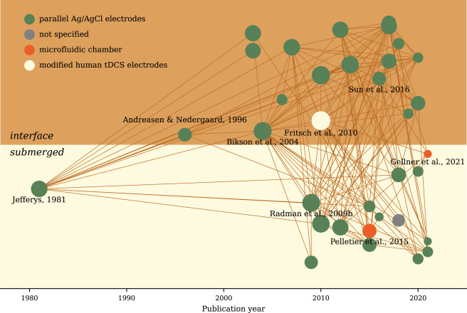

# kirsche

Kirsche is the command line for [Lightkone](https://lightkone.lab.kausalflow.com),
the web reference manager. It works on the same library as the web app: the
plain files in your Cloudflare R2 / S3 bucket, your GitHub repository, or a
folder on disk. Search, add, tag, file, annotate, export BibTeX and draw the
citation map from the terminal, a script or a notebook.

It installs two commands that do the same thing: `kirsche` and `lightkone`.

```bash
pip install kirsche                # or: pipx install kirsche
kirsche login --from-backup lightkone-settings.json   # Lightkone: Settings → Backup → Export settings
kirsche ls author:hinton year:2010-2015
kirsche add 2106.09685 10.1103/PhysRevLett.116.061102 -t lensing -f Physics/GR
kirsche export in:Thesis -o thesis.bib
kirsche map in:Thesis --open        # which of your papers cite which
kirsche open Hinton2012-in -p 3     # read it in the web app, at page 3
```

## What it does

| | |
| --- | --- |
| **Library** | `login` (from a Lightkone settings backup, or by hand: `--provider s3`, `github` or `folder`), `libraries`, `use`, `logout`, `info` |
| **Papers** | `ls` (the app's search syntax: `tag:`, `author:`, `year:2015-2020`, `in:Folder`, `is:starred`, `has:pdf` ...), `show`, `add` (DOI / arXiv), `import` (BibTeX), `tag`, `folder`, `note`, `star`, `trash`, `tags`, `folders` |
| **Files** | `export` (BibTeX, JSON, CSV), `pdf` (download), `attach` (upload, filed like Paperpile), `text` (full text), `highlights` (also as Markdown) |
| **In the browser** | `web` opens Lightkone; `open KEY [--page N]` opens a paper in its reader |
| **Citation map** | `map` (HTML page or JSON), `missing` (works your papers keep citing that the library lacks, `--add` to add them) |

Every change is merged with what the web app, Claude (through Lightkone's MCP
server) or another run saved in the meantime, field by field, the same way the
app does it. Nothing is overwritten. `library.bib` is rewritten on each save,
ready for LaTeX and Overleaf. References for the citation map come from
OpenAlex and go into the same `lightkone/citations.json` the web app uses, so
each paper is looked up only once.

Run `kirsche --help` or `kirsche COMMAND --help` for every option.

## In Python

```python
from kirsche.lightkone import FolderStorage, Library, S3Storage

lib = Library(FolderStorage("~/papers")).load()
for p in lib.search("tag:lensing year:2015-2020"):
    print(p["key"], p["title"])

df = lib.to_dataframe()            # needs pandas
lib.get("Hinton2012-in")["tags"].append("classics")
lib.save()                         # merged with changes made elsewhere
```

## Standalone commands

Kirsche's original commands still work on a .bib file or a list of DOIs, with
no library: `metadata`, `connections`, `connections-from-metadata` and
`visualization` (Semantic Scholar, rate limited to 100 requests per 5 minutes).
See the [docs](https://kausalflow.github.io/kirsche).



[Lu H, Shaner S, Otte E, Asplund M, Vlachos A. A microfluidic perspective on conventional in vitro transcranial direct current stimulation methods. J Neurosci Methods. 2022; 109761. doi:10.1016/j.jneumeth.2022.109761](https://www.sciencedirect.com/science/article/pii/S0165027022002874)
