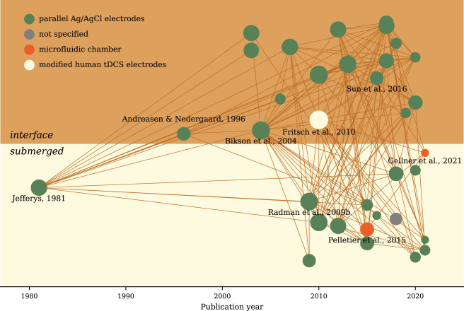

# Documentation for Kirsche

Kirsche, connecting the papers.

> Kirsche is cherry in German.

Kirsche is the command line for [Lightkone](https://lightkone.lab.kausalflow.com), the web reference manager. It works on the same library as the web app (your R2/S3 bucket, GitHub repository or a folder) and installs two names for the same command, `kirsche` and `lightkone`. See [Lightkone from the command line](tutorials/lightkone-cli.md).

Kirsche also still looks into the citations of a list of papers, from a .bib file or DOIs, and connects them, with no library at all: see the [standalone commands](tutorials/index.md).

## Demo



[Lu H, Shaner S, Otte E, Asplund M, Vlachos A. A microfluidic perspective on conventional in vitro transcranial direct current stimulation methods. J Neurosci Methods. 2022; 109761. doi:10.1016/j.jneumeth.2022.109761](https://www.sciencedirect.com/science/article/pii/S0165027022002874)

## Install

```
pip install kirsche
```

To read encrypted Lightkone settings backups, `pip install "kirsche[crypto]"`.

## The Idea

The standalone commands provide a few functionalities:

1. Download the metadata of the given papers. Papers can be given as a list of doi or a bib file.
2. Calculate connections between the given papers.
3. Visualize the connections between the given papers.
